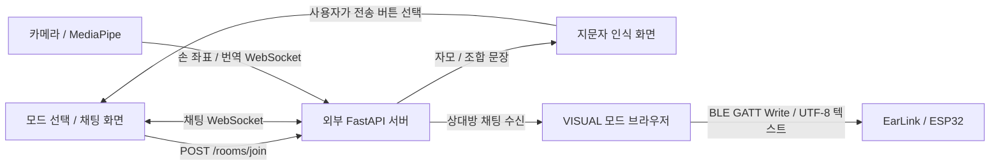

# EarLink 프로젝트 구조 및 통신 분석

분석일: 2026-10-26  
범위: 현재 작업 폴더 `C:\Users\hi\earlink-web`의 소스, 설정, 설치된 의존성.

> 이 문서는 최초 분석 시점의 기록이다. 이후 3칸 출력 구현에서 실행 환경의 Python 경로를 통해 별도 백엔드 `C:\Users\hi\Desktop\EarLink`를 찾았고, 채팅 서버가 원문을 같은 방의 발신자 포함 참가자에게 중계함을 소스로 확인했다. 이 웹 저장소에는 `firmware/`와 BLE v1 프레임·상태·출력 제어가 추가되었다. 현재 구현과 한계는 [펌웨어 안내](../firmware/README.md)를 참고한다.

## 1. 분석 결론과 확인 범위

현재 저장소는 Next.js 프론트엔드다. FastAPI HTTP/WebSocket 클라이언트와 Web Bluetooth GATT 송신 기능이 구현되어 있다. FastAPI 서버 소스와 ESP32 펌웨어는 이 저장소에 없다.

화면·클라이언트 로직의 구현 여부와 실제 서비스 동작 검증을 구분해야 한다. 서버와 실물 기기를 연결한 종단 간 검증은 수행하지 않았다. 별도 저장소의 백엔드나 펌웨어가 미구현이라고 단정할 수 없다.

현재 확인되는 통신 방향은 다음과 같다.



ESP32 → 브라우저 수신 경로, FastAPI → ESP32 직접 통신 경로는 현재 저장소에서 확인되지 않는다.

## 2. 폴더 및 주요 파일

```text
earlink-web/
├─ src/
│  ├─ app/
│  │  ├─ page.tsx                  시작 화면, 방 입장, 채팅 화면 전환
│  │  ├─ layout.tsx                한국어 문서, 메타데이터, 폰트, viewport
│  │  ├─ globals.css               Tailwind 및 전역 스타일
│  │  └─ icon.png                  앱 아이콘
│  ├─ components/
│  │  ├─ entry/
│  │  │  ├─ IntroSplash.tsx        시작 로고와 진행 표시
│  │  │  ├─ ModeSelect.tsx         점자·수어·텍스트 모드 선택
│  │  │  └─ ModeSelectScreen.tsx   입장 로딩·오류 표시
│  │  ├─ layout/
│  │  │  └─ MobileAppShell.tsx     최대 폭 430px 모바일 화면 틀
│  │  ├─ chat/
│  │  │  ├─ ChatScreen.tsx         모드별 입력 UI, 채팅→BLE 전달 정책
│  │  │  ├─ ChatHeader.tsx         모드 표시와 나가기
│  │  │  ├─ MessageList.tsx        발신자별 말풍선, 자동 스크롤
│  │  │  ├─ ChatComposer.tsx       일반 텍스트 입력과 전송
│  │  │  ├─ CameraComposer.tsx     지문자 카메라 컴포넌트 연결
│  │  │  └─ EarLinkConnector.tsx   BLE 연결·해제와 기기 상태 표시
│  │  └─ SignLanguageCamera.tsx    카메라, 손 좌표 오버레이, 인식 결과 전송
│  ├─ hooks/
│  │  ├─ useRoomSession.ts         방 입장 요청, 참가자 상태, 중복 입장 방지
│  │  ├─ useChatSocket.ts          채팅 연결·수신·송신·재연결
│  │  ├─ useEarLinkBluetooth.ts    기기 탐색, GATT 연결, 텍스트 쓰기
│  │  ├─ useSignLanguageCamera.ts  카메라·손 검출·번역 소켓 통합
│  │  └─ sign-language/
│  │     ├─ useCameraStream.ts     카메라 권한, 스트림, 앞뒤 전환, 정리
│  │     ├─ useHandTracking.ts     MediaPipe 로딩, 검출, 시각화
│  │     └─ useSignLanguageSocket.ts 번역 소켓, 손 좌표, reset, 재연결
│  ├─ lib/
│  │  ├─ api.ts                   JSON HTTP 요청과 오류 처리
│  │  ├─ room-api.ts              POST /rooms/join
│  │  ├─ chat.ts                  메시지 길이, 재연결 제한, 로컬 ID
│  │  └─ sign-language/
│  │     ├─ constants.ts          모델 URL, 검출 주기, 버퍼 한도
│  │     └─ utils.ts              카메라 오류 문구, 한글 음절 판별
│  └─ types/
│     ├─ chat.ts                 참가자·채팅 메시지 타입
│     └─ sign-language.ts        손 좌표·번역 응답·카메라 props 타입
├─ public/                       로고, 인물 이미지, 모드 아이콘, 기본 SVG
├─ .env.local                    로컬 FastAPI 주소 설정; Git 제외
├─ package.json                  의존성 및 dev/build/start/lint 명령
├─ package-lock.json             의존성 잠금 파일
├─ next.config.ts                빈 Next 설정; 별도 API 프록시 없음
├─ tsconfig.json                 strict TypeScript, @/* → src/*
├─ eslint.config.mjs             Next 및 TypeScript 린트 규칙
├─ postcss.config.mjs            Tailwind PostCSS 설정
├─ next-env.d.ts                 Next 생성 타입 참조
├─ README.md                     create-next-app 기본 안내
├─ .gitignore                    환경변수·빌드·의존성 파일 제외
├─ .next/                        생성된 Next 개발/빌드 산출물
├─ node_modules/                 설치된 패키지
└─ .git/                         버전 관리 정보
```

`src/app/api/` 또는 Route Handler, Python 서버 코드, DB 모델·마이그레이션, Arduino/ESP-IDF 펌웨어, Docker 구성, 자동 테스트 파일은 확인되지 않았다. 앱은 `/` 페이지에서 React 상태로 화면을 전환한다.

## 3. 기술 스택

| 구분 | 확인 내용 |
|---|---|
| 프레임워크 | Next.js 16.2.12, App Router |
| UI | React / React DOM 19.2.4 |
| 언어 | TypeScript; 설치 버전 5.9.3 |
| 스타일 | Tailwind CSS 4; 설치 버전 4.3.3 |
| 손 검출 | @mediapipe/tasks-vision 0.10.35 |
| 서버 요청 | 브라우저 fetch, 네이티브 WebSocket |
| 기기 연결 | Web Bluetooth API, GATT, @types/web-bluetooth |
| 상태 관리 | React useState/useRef와 커스텀 훅 |
| 백엔드 | 코드 명칭과 URL은 외부 FastAPI를 전제로 함; 구현·버전·DB·추론 라이브러리 미확인 |

Axios, Socket.IO, 별도 전역 상태 관리 라이브러리는 의존성에 없다. MediaPipe WASM과 손 검출 모델은 외부 URL에서 로딩한다. 손 모양을 자모로 분류하는 자체 모델 파일은 없다.

## 4. 프론트엔드와 백엔드 연동 규격

다음은 프론트엔드가 기대하는 규격이며, 실제 서버 구현과 대조한 결과는 아니다.

현재 `.env.local`의 HTTP/WS 대상은 각각 `http://localhost:8000`, `ws://localhost:8000`이다. 코드에도 동일한 기본 주소가 있다.

| 채널 | 경로 | 프론트엔드 동작 |
|---|---|---|
| HTTP POST | `/rooms/join` | 접근성 모드를 보내 참가자와 방 정보 수신 |
| WebSocket | `/ws/rooms/{ROOM_CODE}/{participant_id}` | 일반 문자열 송신, JSON 채팅/오류 수신 |
| WebSocket | `/ws/translate/{ROOM_CODE}/{participant_id}` | 손 좌표·reset JSON 송신, jamo 등 수신 |

### 방 입장

`page.tsx → useRoomSession.enterRoom → joinRoom → requestJson` 순서다.

요청 예시:

```json
{"accessibility_mode":"STANDARD"}
```

예상 응답 형태의 예시:

```json
{
  "participant_id": 1,
  "room_id": 1,
  "room_code": "ABC123",
  "accessibility_mode": "STANDARD",
  "joined_at": "2026-10-26T00:00:00Z"
}
```

프론트엔드는 방 코드를 사용자가 입력하거나 요청에 포함하지 않는다. 어느 사용자를 같은 방으로 배정할지는 서버의 `/rooms/join` 정책을 확인해야 한다. 방 선택·초대 코드 입력 기능은 없다.

입장 성공 후 참가자 상태를 저장하면 채팅 WebSocket이 열린다. 방 코드는 trim 후 대문자로 정규화한다. 나가기는 로컬 상태 초기화와 소켓 정리로 처리하며 별도 HTTP 퇴장 요청은 없다.

### 일반 채팅

1. STANDARD 모드에서 입력 후 전송한다.
2. 공백 제거, 빈 메시지 검사, 최대 길이 1,000, 소켓 OPEN 여부를 검사한다.
3. `socket.send(trimmedMessage)`로 일반 문자열을 전송한다. JSON 객체로 감싸지 않는다.
4. 서버가 아래 형태의 JSON을 보내면 메시지 배열에 추가한다.
5. 수신할 때마다 로컬 ID를 생성하고 `sender_id`로 내 메시지를 구분한다.

```json
{"type":"message","sender_id":1,"content":"안녕하세요"}
```

오류 응답:

```json
{"type":"error","code":"EXAMPLE_ERROR","detail":"오류 설명"}
```

보낸 메시지를 즉시 화면에 추가하는 처리는 없다. 자신의 발신 메시지도 보이려면 서버가 발신자에게 메시지를 다시 보내야 한다. `sendMessage()`의 true는 서버 저장이나 상대방 수신 확인이 아니라 브라우저의 `socket.send()` 호출 완료를 뜻한다.

재연결은 연속 연결 실패 시 최대 5회이며, 지연은 0.5초에서 최대 8초로 증가한다. 정상 연결 시 횟수는 초기화되고, 종료 코드 1008에서는 재연결을 중단한다.

메시지 이력 조회, 새로고침 후 참가자 복구, 메시지 서버 ID, 애플리케이션 ACK, 재전송·오프라인 큐는 없다. 서버가 같은 메시지를 다시 보내면 새 로컬 ID가 생성되므로 서버 재전송에 대한 중복 제거는 되지 않는다.

## 5. 지화·지문자 기능

HEARING 모드는 다음 과정으로 동작하도록 구현되어 있다.

1. MediaPipe를 동적 로딩하고 GPU 초기화 실패 시 CPU로 재시도한다.
2. 카메라를 열고 손 랜드마크를 추출한다. 검출 간격의 하한은 66ms이며 실제 속도는 기기에 따라 달라진다.
3. 최대 두 손을 검출·표시하지만 서버에는 `Left`가 아닌 손 하나를 선택해 보낸다.
4. 선택한 손의 x/y 좌표만 소수 넷째 자리로 반올림하여 전송한다. z 좌표와 영상 프레임은 전송하지 않는다.
5. 서버의 `current`, `composed`, `confidence`를 화면에 표시한다.
6. 사용자가 전송 버튼을 누르면 `composed`를 일반 채팅 소켓으로 보낸다.
7. 이어서 번역 소켓에 reset을 요청한다.

손 좌표 요청 형태(실제 hand에는 선택된 손의 전체 랜드마크 배열이 들어감):

```json
{"type":"hand","frame_id":1,"t":12345,"hand":[[0.5,0.5],[0.51,0.52]]}
```

손이 없으면 `hand`는 null이다. `t`는 `performance.now()` 기반 상대 시각이며 Unix 시각이 아니다. 소켓 송신 버퍼가 64KiB를 초과하면 해당 프레임 전송을 건너뛴다.

응답 예시:

```json
{"type":"jamo","current":"ㄱ","composed":"가","confidence":0.95}
```

초기화 요청/응답:

```json
{"type":"reset"}
{"type":"reset_complete"}
```

`echo`, `error`도 처리하며 `MODEL_UNAVAILABLE`, `MODEL_LOCK_UNAVAILABLE` 오류는 후속 재연결을 차단한다.

**프론트엔드에 구현된 것은 손 검출·좌표 전송·서버 결과 표시다. 자모 분류와 한글 조합은 서버 응답에 의존한다.** 일반 수어 문장 번역 기능이 구현됐다고 볼 근거는 없다. `isCompleteKoreanSyllable()`은 음절 범위를 판별할 뿐이며 현재 사용처가 없다. 인식 문장 입력란은 읽기 전용이어서 수동 수정 기능도 없다.

## 6. 점자·BLE·ESP32 구현 상태

### BLE 연결 규격

`useEarLinkBluetooth.ts`에 다음 값이 하드코딩되어 있다.

| 항목 | 값 |
|---|---|
| 검색할 기기 이름 | `EarLink` 정확히 일치 |
| Service UUID | `8f3a0001-7c3b-4b8a-9f52-123456789abc` |
| Characteristic UUID | `8f3a0002-7c3b-4b8a-9f52-123456789abc` |
| 송신 방식 | `writeValueWithResponse()` |
| 데이터 | `TextEncoder`로 만든 UTF-8 텍스트 바이트 |

사용자 연결 버튼 → requestDevice → gatt.connect → getPrimaryService → getCharacteristic 순서다. 연결 해제 이벤트를 감지하고 상태를 갱신한다.

### 채팅을 기기에 전달하는 정책

`ChatScreen.tsx`에서 다음 조건을 적용한다.

- VISUAL 모드에서만 전달한다.
- BLE 연결 완료 시 이미 존재하던 메시지는 전달하지 않는다.
- 연결 이후 새로 수신한 상대방 메시지만 전달한다.
- 내 메시지와 빈 메시지는 제외한다.
- 동일 로컬 ID는 재처리하지 않는다.
- Promise 큐로 GATT 쓰기를 순차 실행한다.
- 연결 상태 변경 시 세션 번호로 이전 대기 작업을 무효화한다.

이 정책과 UI는 기존 기능을 유지할 때 보존할 대상이다.

### 확인되지 않거나 없는 부분

- 텍스트를 점자 셀·6점 패턴·구동 명령으로 변환하는 코드가 없다.
- 점자 패턴을 텍스트로 변환하는 코드도 없다.
- `startNotifications`, `characteristicvaluechanged`, `readValue`, 수신 디코더가 없다.
- ESP32 버튼·점자 키 입력을 채팅에 보내는 경로가 없다.
- 긴 텍스트의 바이트 단위 분할, 재조립, 메시지 경계 규격이 없다.
- 펌웨어 처리 완료 ACK, 재시도, 기기 상태 수신 기능이 없다.
- 펌웨어의 GATT 속성, 텍스트 처리 방식, 점자 액추에이터 구동은 확인할 수 없다.

**현재 데이터는 점자 변환 결과가 아니라 원문 텍스트다.** 점자 변환을 ESP32가 담당하는 설계라면 해당 펌웨어를 확인해야 한다. 백엔드나 브라우저에서 변환하기로 한 설계라면 그 변환 단계가 추가되어야 한다.

VISUAL 화면은 기기 연결 UI만 제공한다. 텍스트 입력란도, 기기 수신 경로도 없으므로 현재 프론트엔드만으로는 이 모드에서 답장을 보낼 수 없다.

## 7. 완성도 구분

아래의 “구현”은 소스 존재를 뜻하며 실물 검증 완료를 뜻하지 않는다.

| 기능 | 상태 | 남은 확인 |
|---|---|---|
| 시작 화면·모드 선택·채팅 레이아웃 | 프론트 구현 | 실제 브라우저 사용성 |
| 채팅 접근성 기본 속성 | 구현 | role=log, aria-live, 입력 label 등; 사용자 검증 별도 |
| 방 입장 HTTP | 클라이언트 구현 | 서버 라우트·방 배정 규칙 |
| 채팅 송수신·재연결 | 클라이언트 구현 | 서버 echo/broadcast와 여러 사용자 시험 |
| 카메라·MediaPipe 검출 | 클라이언트 구현 | 카메라 권한·외부 모델 로딩·기기 성능 |
| 지문자 인식 결과 표시·전송 | 클라이언트 구현 | 서버 모델·조합기·정확도 |
| BLE 탐색·연결·텍스트 송신 | 클라이언트 구현 | 실제 GATT 규격·긴 메시지 |
| 점자 변환 | 현재 저장소에 없음 | 별도 백엔드/펌웨어 존재 여부 |
| ESP32 → 웹 수신 | 프론트 미구현 | 수신 characteristic과 입력 프로토콜 |
| VISUAL 모드 답장 | 프론트 경로 없음 | 기기 입력 또는 대체 입력 |
| 대화 이력·세션 영속화 | 프론트 미구현 | 서버 저장 정책도 미확인 |
| 서비스 소개·이용 방법·메뉴 | 정적 문구/비활성 UI | 동작 없음 |
| 백엔드·펌웨어 전체 구현 | 확인 불가 | 별도 소스 필요 |

## 8. 연동 전 우선 확인할 문제

1. **백엔드와 기기 규격의 기준이 필요하다.** 현재 코드에서 추출한 HTTP·WS·GATT 규격을 실제 FastAPI와 펌웨어에 대조해야 한다. 기존 구현을 확인하기 전에 새로운 서버나 UUID를 임의로 도입하면 호환성을 깨뜨릴 수 있다.
2. **VISUAL 입력 경로가 없다.** 기기에서 notify로 무엇을 보내는지, 원문인지 점자 입력 코드인지 정해야 한다.
3. **BLE 전송 실패가 사용자에게 보이지 않는다.** ChatScreen은 보내기 전에 처리 ID를 등록하고 실패 시 콘솔만 기록한다. 실패한 메시지는 자동 재전송되지 않는다.
4. **BLE 수명 관리가 부족하다.** 훅에 언마운트 정리 effect가 없고 방 나가기도 disconnect를 호출하지 않는다. 등록한 연결 해제 리스너를 제거하지 않으며 연결 중 중복 클릭 차단도 없다.
5. **긴 한국어 메시지 처리가 필요하다.** 채팅 길이 제한과 UTF-8 바이트 길이는 다르지만 전체 메시지를 한 번에 쓴다. 실제 기기 허용 크기와 분할·재조립 규격을 확인해야 한다.
6. **연결 오류 안내가 일부 화면에서 빠진다.** ChatHeader는 chatStatus prop을 선언하지만 렌더링에 사용하지 않는다. VISUAL 분기에는 chatErrorMessage도 전달하지 않는다.
7. **서버 응답 검증이 충분하지 않다.** HTTP 성공 응답은 타입 단언으로 반환한다. 채팅/번역 JSON도 null 또는 예상하지 못한 자료형을 완전히 검증하지 않는다.
8. **인식 문장 초기화 동기화를 확인해야 한다.** reset 완료 전 도착하는 jamo를 차단하는 상태가 없어 이전 결과가 다시 표시될 가능성이 있다.

배포·실기기 연결 때에는 HTTP/WS 주소가 같은 백엔드를 가리키는지, 브라우저에서 해당 서버에 접근 가능한지, HTTP CORS와 WS 연결 허용 정책이 맞는지도 확인해야 한다. 휴대폰에서 localhost는 휴대폰 자신을 가리키므로 현재 로컬 주소를 그대로 사용할 수 있는 구성인지 검토해야 한다.

## 9. 검증 결과

| 검사 | 결과 |
|---|---|
| `node node_modules/typescript/bin/tsc --noEmit --incremental false` | 통과 |
| `npm.cmd run lint` | 오류 2건 |
| `127.0.0.1:3000` TCP | ECONNREFUSED |
| `127.0.0.1:8000` TCP | ECONNREFUSED |
| `http://localhost:8000/openapi.json` GET | ECONNREFUSED |
| 프로덕션 빌드 | 실행하지 않음 |
| 실제 카메라·BLE·다중 사용자 통신 | 검증하지 않음 |

린트 오류:

- `src/hooks/sign-language/useSignLanguageSocket.ts:381`: useCallback 초기화 안의 connectWebSocket 자기 참조에 대해 `react-hooks/immutability` 오류.
- `src/hooks/useSignLanguageCamera.ts:139`: effect 본문의 동기 setState에 대해 `react-hooks/set-state-in-effect` 오류.

이는 현재 설정의 정적 검사 실패다. 두 오류만으로 실제 런타임 기능이 모두 실패한다고 단정하지 않는다.

## 10. 기존 기능을 유지하는 구현 순서

1. 별도 FastAPI·ESP32 소스를 확보해 현재 세 엔드포인트와 GATT UUID를 대조한다.
2. 방 배정과 채팅 broadcast를 확인하고 두 클라이언트의 STANDARD 채팅을 검증한다.
3. HEARING 모드의 손 좌표 → jamo/composed → 사용자 전송 → reset 흐름을 검증한다.
4. VISUAL 모드의 새 상대방 메시지 → BLE 텍스트 → 실제 점자 출력 흐름을 검증한다.
5. 기존 notify characteristic 또는 합의한 규격에 맞춰 ESP32 → 브라우저 → 채팅 입력 경로를 추가한다.
6. BLE 연결 정리, 실패 표시, 바이트 분할·완료 확인을 보완하고 기존 전달 정책의 회귀 여부를 확인한다.
7. 린트 오류를 정리한 뒤 통합 검증과 실행 안내를 문서화한다.

현재 분석에서는 애플리케이션 소스와 환경 설정을 변경하지 않았으며 이 문서만 추가했다.
